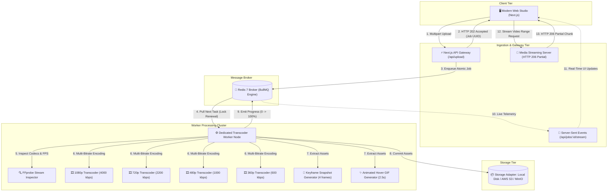

# StreamForge ⚡ Distributed Asynchronous Video Transcoding Pipeline

[](https://nextjs.org/)
[](https://www.typescriptlang.org/)
[](https://docs.bullmq.io/)
[](https://redis.io/)
[](https://ffmpeg.org/)
[](https://www.docker.com/)
[](https://aws.amazon.com/s3/)
[](LICENSE)

An **enterprise-grade, production-ready distributed video transcoding and media processing pipeline**. Built to demonstrate advanced backend system design, distributed message queues, asynchronous background worker pools, non-blocking ingestion APIs, and streaming media delivery.

---

## 🎯 The Core Problem & Solution

### ⚠️ The Problem with Naive Implementations
Video encoding is notoriously CPU and I/O intensive. When API servers handle video conversion synchronously inside HTTP request handlers:
- **Event Loop Starvation**: Node.js or web threads block during FFmpeg encoding.
- **HTTP Gateway Timeouts**: Reverse proxies (NGINX, Cloudflare, ALB) terminate connections after 30–60 seconds while encoding takes minutes.
- **Cascading Server Failures**: A spike of 5 simultaneous 4K video uploads crashes the entire web API and takes down all users.

### 🛡️ The StreamForge Distributed Architecture Solution
StreamForge decouples the user-facing web tier from the computing-heavy encoding tier using a **Producer-Consumer Message Queue pattern**:
1. **Immediate Ingestion (`HTTP 202 Accepted`)**: The Next.js API ingests raw video blobs and immediately enqueues an atomic job descriptor in Redis before returning in < 50ms.
2. **Decoupled Worker Nodes**: Standalone background workers pull jobs atomically from BullMQ, process them with concurrency controls, and report live progress.
3. **Real-Time Telemetry (SSE)**: Clients subscribe to Server-Sent Events (`/api/jobs/[id]/stream`) for millisecond-level telemetry without polling overhead.
4. **Range-Seek Video Streaming**: Transcoded files are delivered with **HTTP 206 Partial Content** and `-movflags +faststart` for zero-lag scrubbable playback.

---

## 🏛️ High-Level System Architecture (HLD)



---

## ✨ Features & Engineering Highlights

- ⚡ **Multi-Bitrate Renditions**:
  - Automatically transcodes videos into **1080p, 720p, 480p, and 360p** renditions with tailored video and audio bitrates.
  - Intelligent resolution capping: Never upscales low-res videos to prevent wasted bandwidth and compute.
- 🚀 **Instant Web Streaming (`-movflags +faststart`)**:
  - Repositions the MP4 `moov atom` header from the end of the file to the beginning, allowing web browsers to begin playing immediately without downloading the full asset.
- 🔍 **Automated Metadata Extraction**:
  - Uses `ffprobe` to inspect duration, width, height, container formats, video codecs (H.264/HEVC), audio codecs (AAC), bitrate, and exact FPS.
- 📸 **Multi-Timecode Thumbnails & Animated Preview GIF**:
  - Captures 4 distributed snapshot frames at 15%, 35%, 60%, and 85% timestamps.
  - Generates a 2.5-second lightweight animated hover preview GIF (YouTube-style preview).
- 🔄 **Fault-Tolerant Queue & Exponential Backoff**:
  - Powered by **BullMQ** with configurable worker concurrency (default 2 per worker).
  - Exponential backoff retry strategies (5s, 10s, 20s) with atomic distributed lock renewal to prevent duplicate executions.
- 🌐 **Pluggable Storage Drivers**:
  - Seamlessly switch between **Local Disk Storage** and **AWS S3 / MinIO (S3-compatible)** via a single environment variable (`STORAGE_DRIVER=s3`).
- 🎬 **HTTP 206 Partial Content Media Server**:
  - High-performance byte-range streaming server with `Accept-Ranges: bytes` allowing smooth timeline scrubbing and seeking.
- 💻 **1-Click Synthetic Video Test Generator**:
  - Includes a built-in test pattern generator (`node scripts/generate-sample-video.cjs`) so reviewers can test the pipeline with 1 click without needing a video file.

---

## 🛠️ Tech Stack & Architecture Choices

| Component | Technology | Rationale & Why It Was Chosen |
|---|---|---|
| **Frontend & API** | **Next.js 16 (Turbopack, React 19)** | Serverless-ready API routes, Server-Sent Events, modern responsive glassmorphic UI. |
| **Task Queue** | **BullMQ & Redis** | Industry standard for distributed task processing, job priorities, and atomic locks. |
| **Media Processing** | **FFmpeg & Fluent-FFmpeg** | Low-level C/C++ media framework for hardware/software video transcoding. |
| **Cloud Storage** | **AWS S3 & @aws-sdk/client-s3** | Scalable, highly available cloud object storage with presigned streaming. |
| **Containerization** | **Docker & Docker Compose** | Microservice isolation: separate containers for Web Gateway, Redis, Worker, and MinIO. |
| **Language** | **TypeScript 5.x** | End-to-end type safety across API payloads, queue events, and worker jobs. |

---

## 📁 Repository Structure

```
├── docker-compose.yml          # Multi-container orchestration (Redis + Web + Worker + MinIO)
├── Dockerfile                  # Production container image with bundled FFmpeg
├── next.config.mjs             # Next.js bundler config with external native binaries
├── package.json                # Dependencies and orchestration scripts
├── tsconfig.json               # TypeScript compiler options
├── .env.example                # Configuration template
├── storage/                    # Persistent media mount
│   ├── raw/                    # Ingested raw video files
│   └── outputs/                # Transcoded multi-resolution files & thumbnails
├── scripts/
│   └── generate-sample-video.cjs # Instant 5-second test video generator
└── src/
    ├── app/                    # Next.js App Router
    │   ├── api/
    │   │   ├── upload/route.ts       # Non-blocking multipart video upload
    │   │   ├── jobs/route.ts         # List queue jobs and state metrics
    │   │   ├── jobs/[id]/route.ts    # Single job details
    │   │   ├── jobs/[id]/stream/route.ts # Server-Sent Events (SSE) telemetry
    │   │   ├── media/[...path]/route.ts  # HTTP 206 Partial Content streaming server
    │   │   ├── sample/route.ts       # 1-Click test pipeline trigger
    │   │   └── stats/route.ts        # Redis queue depth & memory metrics
    │   ├── layout.tsx          # Root HTML layout with SEO metadata
    │   ├── page.tsx            # Interactive Studio, Real-time Pipeline Monitor & Player
    │   └── globals.css         # Dark-mode design system & animations
    ├── config/
    │   └── env.ts              # Centralized environment variables
    ├── lib/
    │   ├── ffmpeg.ts           # Cross-platform FFmpeg/FFprobe binary resolution
    │   ├── queue.ts            # BullMQ Queue instance & job dispatcher
    │   ├── queue-manager.ts    # Unified queue engine with auto-fallback
    │   ├── redis.ts            # Redis connection singleton
    │   ├── storage.ts          # Storage abstraction layer (Local + AWS S3)
    │   └── types.ts            # TypeScript interfaces
    └── worker/
        ├── index.ts            # Standalone worker daemon entrypoint
        ├── processor.ts        # Transcode orchestrator (Probe -> Transcode -> Thumbnails)
        └── transcoder.ts       # FFmpeg multi-bitrate execution engine
```

---

## 🚀 Getting Started

### Prerequisites
- **Node.js**: v18+ (tested on Node.js v20 and v24)
- **Redis**: Optional for local dev (built-in automatic fallback engine included), required for multi-worker distributed mode.

### 1. Clone & Install
```bash
git clone https://github.com/your-username/streamforge-video-pipeline.git
cd streamforge-video-pipeline
npm install
```

### 2. Configure Environment
Create a `.env` file from the template:
```bash
cp .env.example .env
```

### 3. Generate a Test Video (Optional)
Generate a synthetic 5-second color test video pattern with 1 command:
```bash
node scripts/generate-sample-video.cjs
```

### 4. Run Locally
Run both the Web App and the Background Worker concurrently:
```bash
npm run dev:all
```
Open **[http://localhost:3000](http://localhost:3000)** in your browser!

> **Tip:** You can also run the web server and worker in separate terminal windows:
> - Terminal 1: `npm run dev` (Starts Next.js Web Studio)
> - Terminal 2: `npm run worker` (Starts Background Transcoder Worker)

---

## 🐳 Docker & Docker Compose Setup

Run the entire distributed microservice stack (Redis 7 + Web Gateway + Background Worker + MinIO S3) with a single command:

```bash
docker-compose up --build
```

- **Web Studio & API**: `http://localhost:3000`
- **Redis Broker**: `localhost:6379`
- **MinIO Cloud Storage Console**: `http://localhost:9001` (Credentials: `streamadmin` / `streamsecretkey123`)

---

## 📡 API Specification

### 1. Upload Video & Enqueue Task
```http
POST /api/upload
Content-Type: multipart/form-data

[Form field "video": binary file]
```
**Response (`202 Accepted`):**
```json
{
  "success": true,
  "jobId": "a93df231-7e81-4328-9844-3c66adbe482c",
  "fileName": "demo.mp4",
  "fileSizeBytes": 15482910,
  "status": "queued",
  "message": "Video successfully uploaded and enqueued for asynchronous processing."
}
```

### 2. Stream Live Progress (Server-Sent Events)
```http
GET /api/jobs/{jobId}/stream
Accept: text/event-stream
```
**SSE Stream Event Sample:**
```json
data: {"id":"a93df231","status":"active","progress":45,"progressMessage":"Encoding 720p (60%)...","currentStage":"transcode"}
```

### 3. Fetch Job Details & Renditions
```http
GET /api/jobs/{jobId}
```
**Response (`200 OK`):**
```json
{
  "success": true,
  "job": {
    "id": "a93df231",
    "status": "completed",
    "progress": 100,
    "result": {
      "metadata": { "width": 1920, "height": 1080, "duration": 42.5, "fps": 30, "codec": "h264" },
      "renditions": [
        { "resolution": "1080p", "bitrate": "4000k", "fileUrl": "/api/media/a93df231/1080p.mp4" },
        { "resolution": "720p", "bitrate": "2200k", "fileUrl": "/api/media/a93df231/720p.mp4" },
        { "resolution": "480p", "bitrate": "1000k", "fileUrl": "/api/media/a93df231/480p.mp4" },
        { "resolution": "360p", "bitrate": "600k", "fileUrl": "/api/media/a93df231/360p.mp4" }
      ],
      "thumbnails": ["/api/media/a93df231/thumb_1.jpg", "/api/media/a93df231/thumb_2.jpg"],
      "previewGif": "/api/media/a93df231/preview.gif",
      "processingTimeMs": 14200
    }
  }
}
```

### 4. Byte-Range Media Streaming (HTTP 206)
```http
GET /api/media/{jobId}/{filename}
Range: bytes=0-1048576
```
**Response Headers:**
```http
HTTP/1.1 206 Partial Content
Accept-Ranges: bytes
Content-Range: bytes 0-1048576/15482910
Content-Type: video/mp4
```

---

## ☁️ Production Cloud Deployment (AWS Architecture)

For enterprise-scale workloads handling millions of videos:

```
                  +-----------------------------------------+
                  |         Amazon Route 53 (DNS)           |
                  +--------------------+--------------------+
                                       |
                                       v
                  +-----------------------------------------+
                  |    Application Load Balancer (ALB)      |
                  +--------------------+--------------------+
                                       |
                   +-------------------+-------------------+
                   |                                       |
                   v                                       v
    +-------------------------------+       +-------------------------------+
    | Next.js API ECS Task (AZ-1)   |       | Next.js API ECS Task (AZ-2)   |
    +---------------+---------------+       +---------------+---------------+
                    |                                       |
                    +-------------------+-------------------+
                                        |
                   +--------------------+--------------------+
                   |                                         |
                   v                                         v
    +------------------------------+          +------------------------------+
    | AWS ElastiCache for Redis    |          | Amazon S3 (Raw & Processed)  |
    | (Managed BullMQ Cluster)     |          | (Lifecycle to Glacier)       |
    +--------------+---------------+          +--------------+---------------+
                   |                                         |
                   | Atomic Pull                             | Presigned Reads
                   v                                         v
    +------------------------------------------------------------------------+
    |      Auto-Scaling Transcoding Worker Pool (AWS ECS Fargate / EC2)      |
    |      (Scale Out based on BullMQ Queue Depth & CPU Utilization)         |
    +------------------------------------------------------------------------+
                                       |
                                       v
                  +-----------------------------------------+
                  |       Amazon CloudFront (CDN)           |
                  |  Global Edge Caching for Media Renditions|
                  +-----------------------------------------+
```

1. **API Tier**: Deployed on **AWS ECS Fargate** behind an Application Load Balancer (ALB) with SSL termination.
2. **Task Queue**: Managed **AWS ElastiCache for Redis** with multi-AZ replication.
3. **Worker Cluster**: Auto-scaling group of GPU/compute-optimized EC2 instances (`c6i` or `g4dn` instances) or ECS Fargate workers scaling dynamically based on queue depth metrics (`QueueSize > 10`).
4. **Storage & CDN**: Raw uploads and transcoded renditions stored in **Amazon S3** distributed globally through **Amazon CloudFront CDN**.

---

## 🛡️ License

This project is licensed under the MIT License - see the [LICENSE](LICENSE) file for details.
